<div align="center">


# Kitsunewave

**Follow the fox-fire to your next favorite anime.**
Browse, search, schedule and stream — one tail at a time.


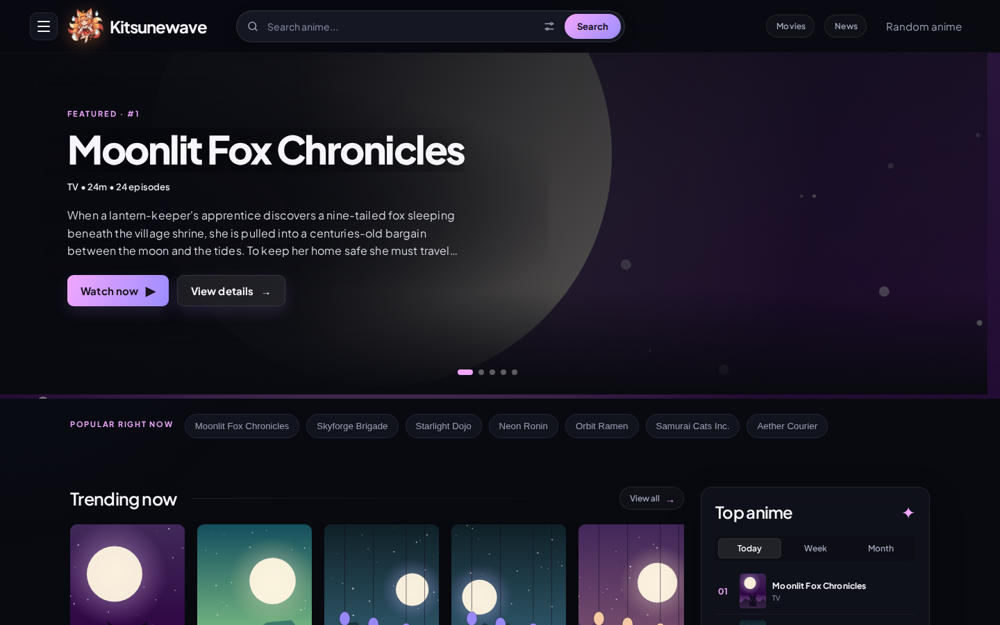

</div>

> **About the screenshots:** every image in this README is rendered from **fictional mock data** and generated placeholder artwork. No real titles, posters, characters or news articles are shown. See [Regenerating the screenshots](#regenerating-the-screenshots).

---

## Table of contents

- [Features](#features)
- [Screenshots](#screenshots)
- [Tech stack](#tech-stack)
- [Project structure](#project-structure)
- [Getting started](#getting-started)
- [Configuration](#configuration)
- [Accounts and library](#accounts-and-library)
- [How the API layer works](#how-the-api-layer-works)
- [Pages and routes](#pages-and-routes)
- [Deployment](#deployment)
- [Regenerating the screenshots](#regenerating-the-screenshots)
- [Credits and disclaimer](#credits-and-disclaimer)

---

## Features

**Discover**
- **Spotlight hero** — featured anime carousel that auto-advances every 6 seconds, with dot navigation and swipe / drag support.
- **Home rails** — *Trending now*, *Top airing*, *Most popular*, *New episodes*, *New additions* and *Just completed*, each with a **View all** link.
- **Top anime** — ranked top 10 with **Today / Week / Month** tabs.
- **Popular right now** — one-click shortcuts for the most searched titles.
- **Browse more** — lists such as Most favorite, Top upcoming, Subbed, Dubbed, Movies, TV, OVA, ONA and Specials, plus genre chips and a producer search.
- **Anime A–Z** — jump to titles by letter from the footer.
- **Random anime** — open a surprise pick from the header or menu.

**Search and filter**
- **Live search suggestions** — debounced suggestions (up to 6) while you type.
- **Filter modal** — type, status, rating, score, season, language, sort order and multi-select genres.
- **Paginated results** for search, filters, lists and genres.

**Plan**
- **7-day anime schedule** — day tabs with release time and episode number; long days collapse to the first 8 with **Show more**.

**Watch**
- **Watch page** — episode picker, **SUB / DUB** toggle, filler tags, multiple player servers (*Kitsune 1, 2, 3 …*) and a related-anime sidebar.
- **Autoplay** — starts muted until the first user interaction, so browsers don't block it.
- **DUB fallback** — if no dub servers are returned, the sub servers are retried with a `/dub` path.

**Read**
- **Anime details** — synopsis with *Read more*, Japanese title, premiere season, SUB / DUB episode counts, studios, genres, next-episode airing time and a **characters** grid with profile preview.
- **Anime news** — latest headlines and an in-app article reader with full text.

**Everything else**
- Fully **responsive** layout with a slide-in menu drawer on mobile.
- Skeleton loaders for every major view.
- Serverless API proxy that hides the upstream API URL from the browser.

---

## Screenshots

### Home

| Hero, popular searches and rails | Rails and Top anime |
| :---: | :---: |
|  | 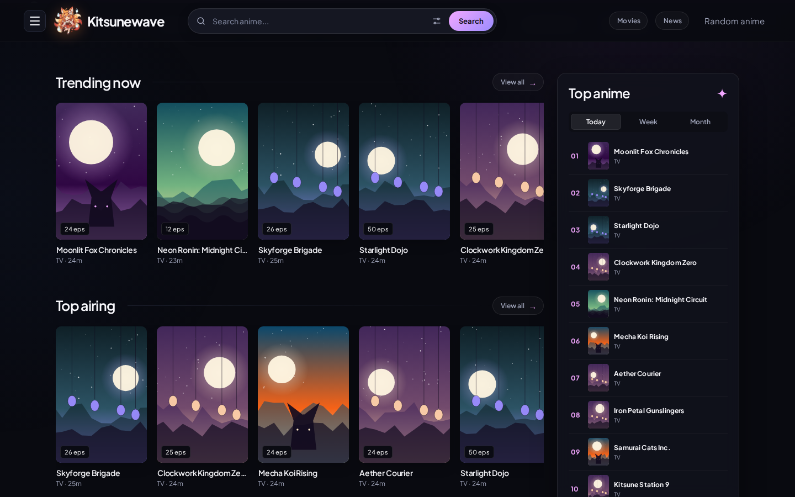 |

### Schedule

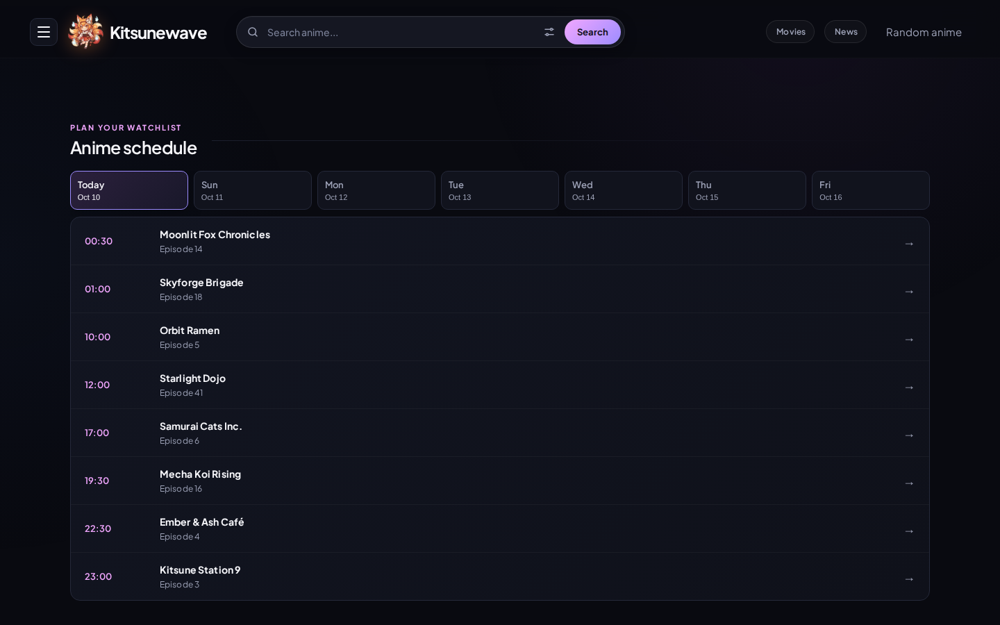

### Search, filters and menu

| Live suggestions | Search results |
| :---: | :---: |
| 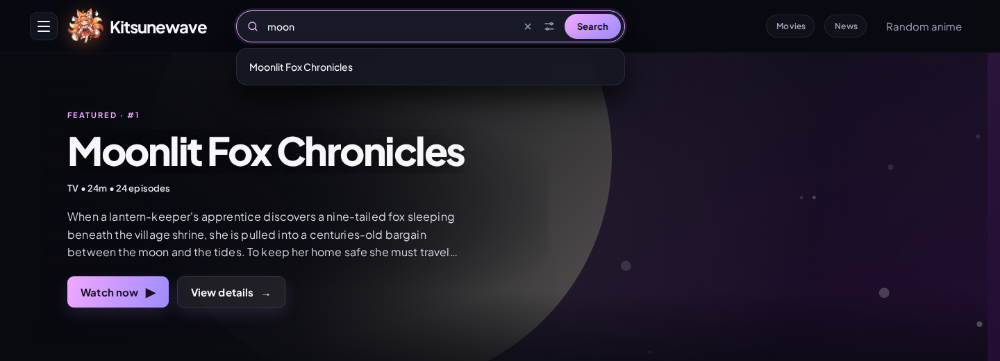 | 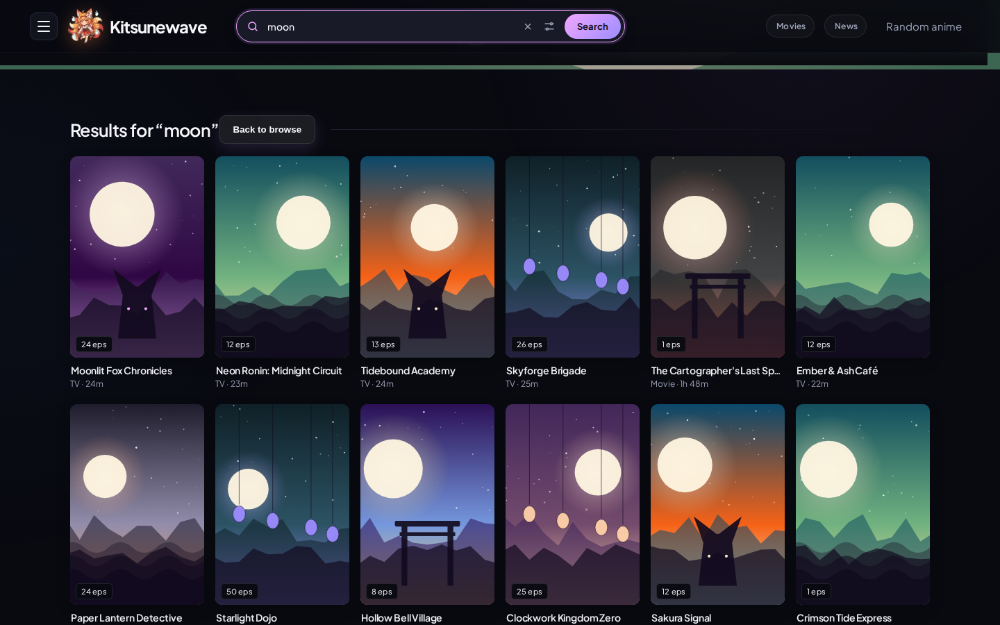 |

| Filter anime | Menu drawer |
| :---: | :---: |
| 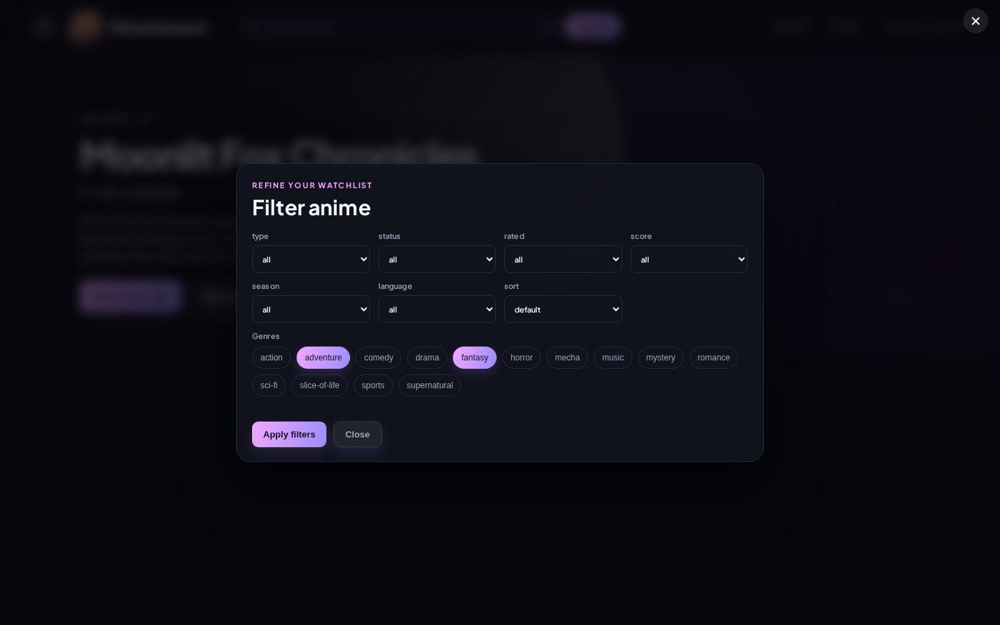 | 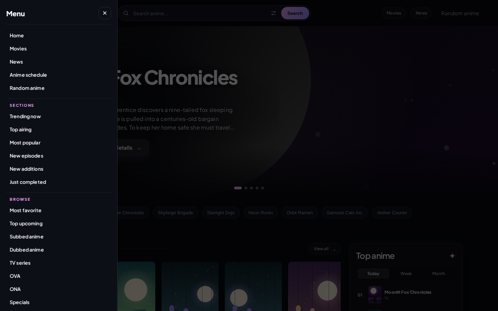 |

### Movies

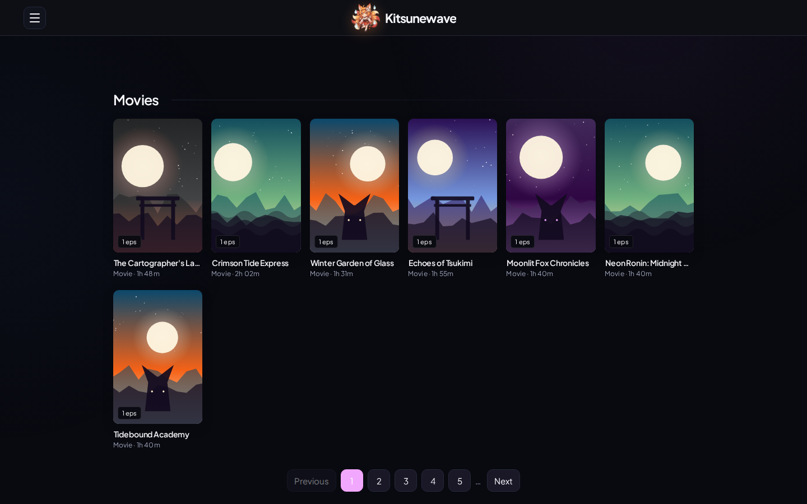

### Anime details

| Details | Characters |
| :---: | :---: |
| 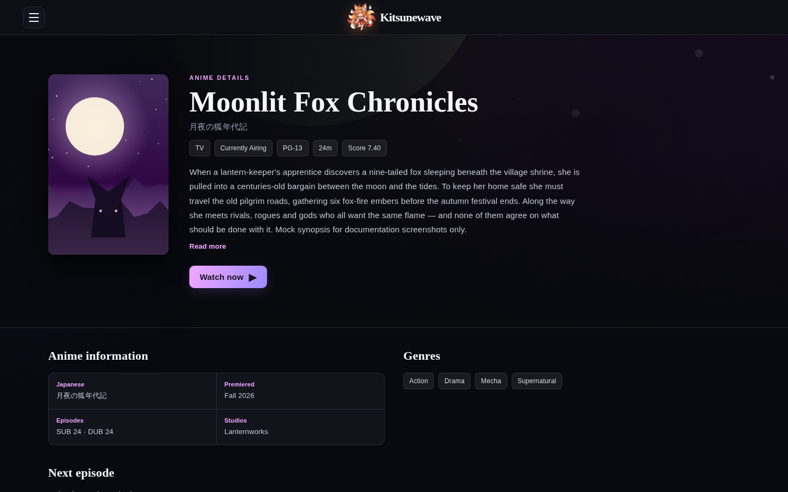 | 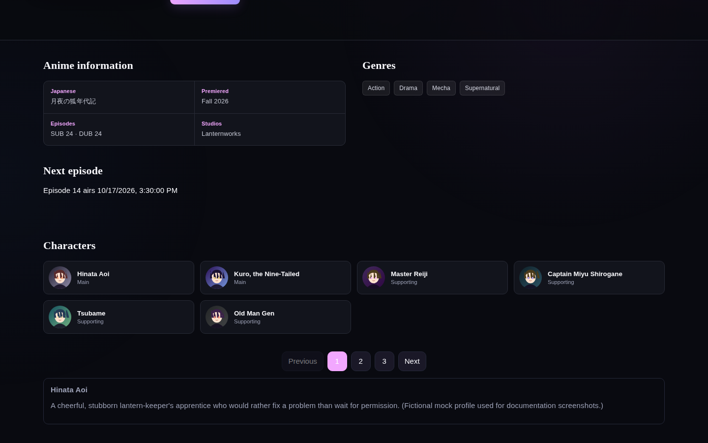 |

### Watch

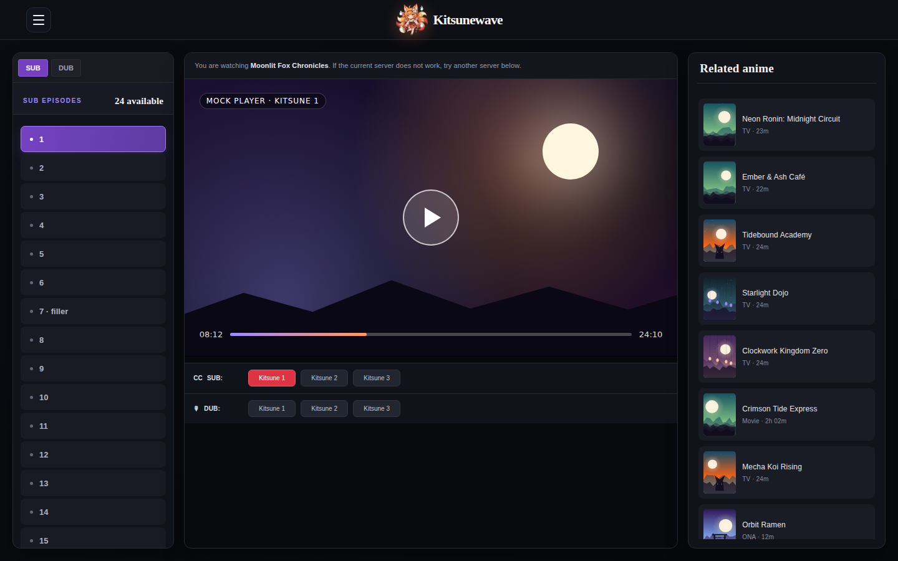

> The player area shows a placeholder page in these screenshots. In the real app it embeds the iframe servers returned by the API.

### News

| News feed | Article reader |
| :---: | :---: |
| 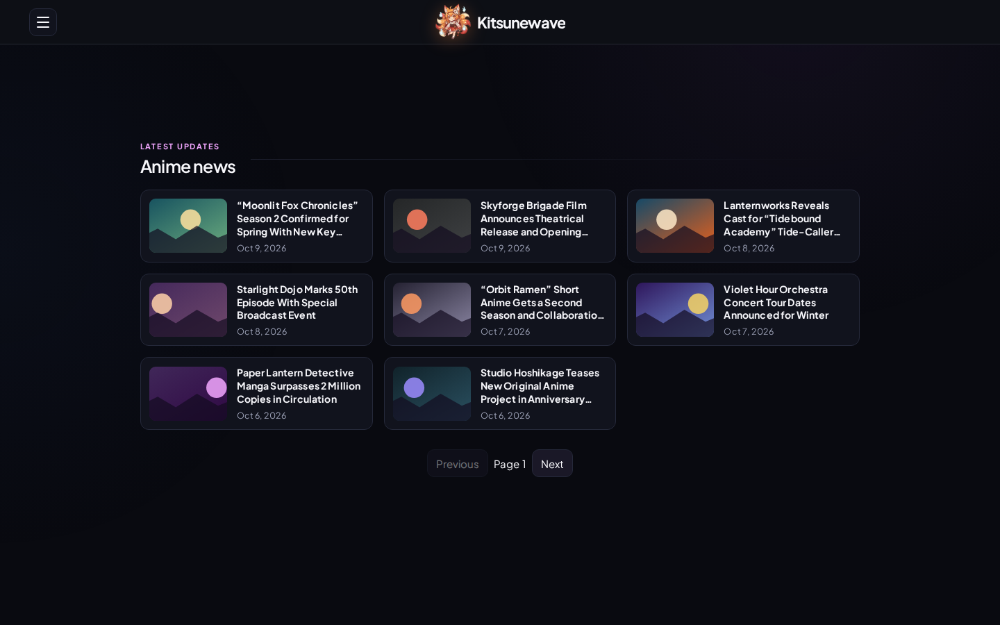 | 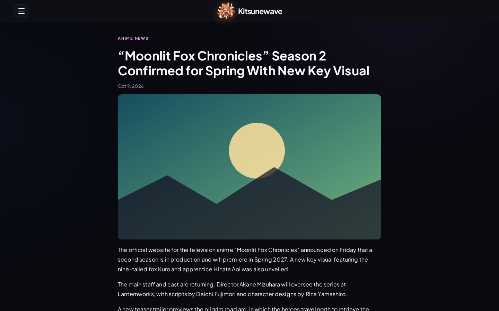 |

### Mobile

| Home | Rails | Menu | Watch |
| :---: | :---: | :---: | :---: |
| 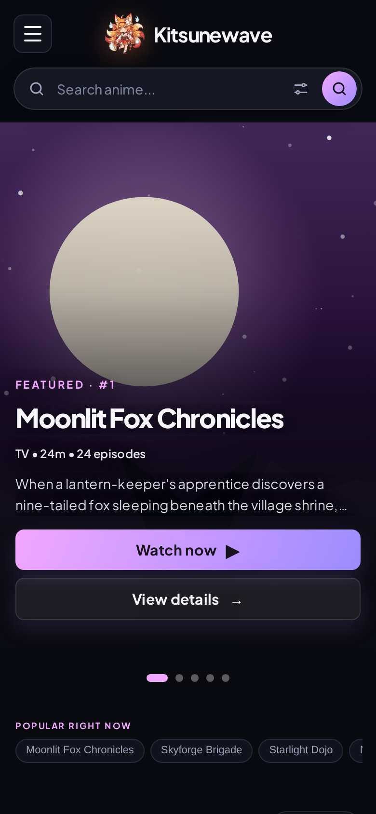 | 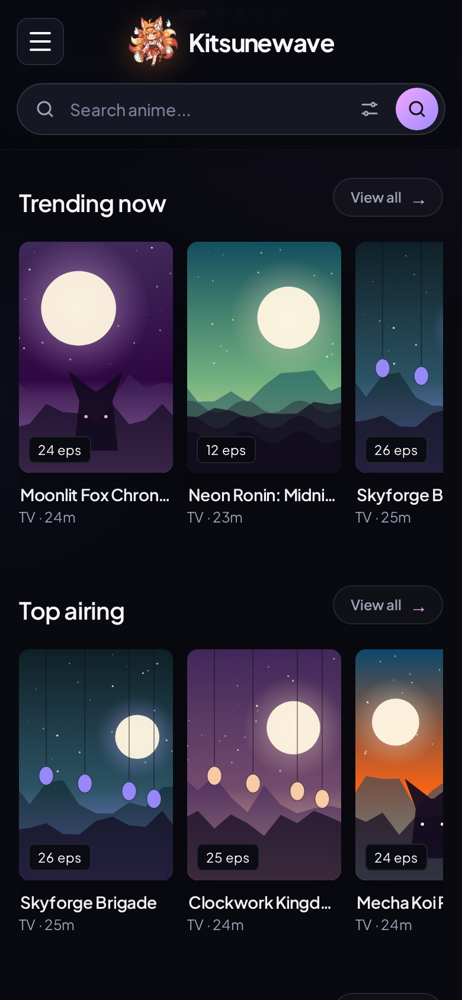 | 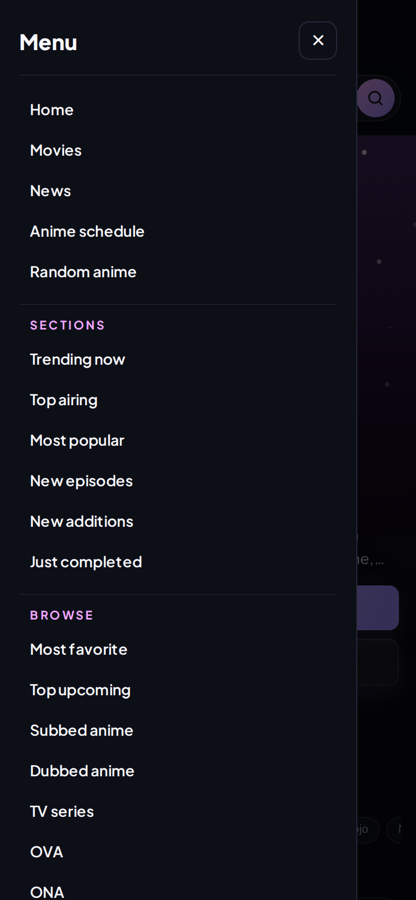 | 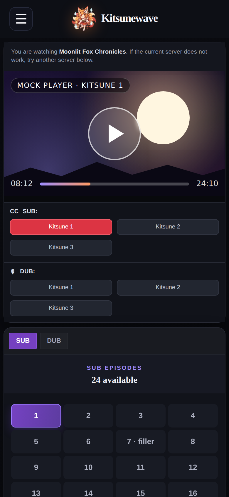 |

---

## Tech stack

| Area | Technology |
| --- | --- |
| UI | [React 19](https://react.dev) (function components and hooks) |
| Build tool | [Vite 7](https://vite.dev) with `@vitejs/plugin-react` |
| Pages | Vite multi-page app (six HTML entry points sharing one `src/main.jsx`) |
| Styling | Plain CSS (`src/styles.css`), [Plus Jakarta Sans](https://fonts.google.com/specimen/Plus+Jakarta+Sans) |
| API layer | Vercel serverless functions (`/api`) |
| Hosting | [Vercel](https://vercel.com) |

There are no routing or state-management libraries: each HTML page mounts the same React bundle, and `App()` picks a view from `location.pathname`.

---

## Project structure

```text
Kitsune/
├── api/
│   ├── proxy.js            # Main serverless proxy (rewritten from /api/*)
│   ├── [...path].js        # Catch-all proxy handler (strict same-origin check)
│   └── news-article.js     # Scrapes full article text for the news reader
├── docs/
│   ├── screenshots/        # Images used in this README
│   └── mock/               # Mock API + script that generates the screenshots
├── public/
│   └── kitsune-logo.png
├── src/
│   ├── main.jsx            # All views: Home, Detail, Watch, News, Movies …
│   └── styles.css
├── index.html              # Home
├── detail.html             # Anime details
├── watch.html              # Player
├── movie.html              # Movies list
├── news.html               # News feed
├── news-detail.html        # News article
├── vercel.json             # Rewrites /api/* to the proxy
├── vite.config.js          # Multi-page build + dev proxy
└── package.json
```

---

## Getting started

### Prerequisites

- [Node.js](https://nodejs.org) 20.19+ or 22.12+ (required by Vite 7)
- npm

### Install and run

```bash
git clone https://github.com/Jeysixczs/Kitsunewave.git
cd Kitsunewave
npm install
npm run dev
```

Vite prints a local URL (by default `http://localhost:5173`). In development, requests to `/api` are proxied to the upstream API configured in `vite.config.js`, and `/api/news-article` is served by the local article scraper.

### Scripts

| Command | What it does |
| --- | --- |
| `npm run dev` | Start the Vite dev server with hot reload |
| `npm run build` | Create a production build in `dist/` |
| `npm run preview` | Serve the production build locally |

---

## Configuration

These environment variables are used by the serverless functions in production. Set them in your Vercel project (**Settings → Environment Variables**).

| Variable | Required | Description |
| --- | :---: | --- |
| `UPSTREAM_API` | Yes | Base URL of the anime API that `/api/proxy` forwards to. Without it the proxy returns `500 UPSTREAM_API is not set`. |
| `ALLOWED_ORIGINS` | No | Comma-separated list of extra origins allowed to call the API from a browser (for example `https://my-client.vercel.app,https://other.example.com`). `localhost` and `127.0.0.1` are always allowed. |

Local `.env*` files are git-ignored.

---

## Accounts and library

Sign in to keep your **watch list, bookmarks, watched anime, continue watching and watch history** on every device.

- **Guests work too.** Without an account, everything is saved in the browser (`localStorage`). On sign-in the guest list is merged into the account.
- **Continue watching** resumes at the last episode you opened (the player is a third-party embed, so playback time can't be read). It shows on the home page and in **My library** (`/library.html`).
- **Mark watched** moves an anime to *Watched* and removes it from *Watch list* and *Continue watching*.
- **Profile** (`/profile.html`) — display name, avatar (a preset emoji), library stats and password change. Name and avatar are stored in the Supabase user metadata, so no extra table is needed.

Accounts use [Supabase](https://supabase.com) (email + password, optional Google). Each person's library is one row protected by row level security.

1. Create a Supabase project and run [`supabase/schema.sql`](supabase/schema.sql) in the SQL editor.
2. In **Project Settings → API** copy the project URL and the `anon` key.
3. Set them as environment variables (locally in `.env`, on Vercel under **Settings → Environment Variables**), then redeploy:

   | Variable | Purpose |
   | --- | --- |
   | `VITE_SUPABASE_URL` | Supabase project URL |
   | `VITE_SUPABASE_ANON_KEY` | Public `anon` key (safe in the browser; RLS protects the data) |
   | `VITE_AUTH_GOOGLE` | `true` to show "Continue with Google" (enable the provider in Supabase first) |

4. In **Authentication → URL Configuration** add your site URL (and `http://localhost:5173` for development) to the redirect URLs.

Without these variables the app still works; the Sign in button is hidden and lists stay on the device.

## How the API layer works

The browser never talks to the upstream API directly.

```text
Browser ──► /api/<endpoint> ──► vercel.json rewrite ──► /api/proxy?path=<endpoint> ──► UPSTREAM_API/<endpoint>
```

1. The frontend calls `/api/...` and adds an `X-Kitsune-Client: web` header to every request.
2. `vercel.json` rewrites `/api/:path*` to `/api/proxy?path=:path*`.
3. `api/proxy.js` only answers requests that look like they come from the site itself: the `X-Kitsune-Client` header, `Sec-Fetch-Site: same-origin`, or a matching `Referer` host. Typing an API URL into the address bar returns `403`.
4. Allowed requests are forwarded to `UPSTREAM_API`. Responses are always JSON and are cached privately in the browser for 5 minutes (`Cache-Control: private, max-age=300`), so a shared CDN cache can't bypass the check above.
5. `GET /api/news-article?id=<id>` is handled by `api/news-article.js`, which accepts only a numeric article id, uses a fixed source host and extracts the article paragraphs.

### Endpoints used by the frontend

| Endpoint | Used for |
| --- | --- |
| `/home` | Spotlight, rails and Top anime |
| `/top-search`, `/suggestion?keyword=` | Popular searches and live suggestions |
| `/search?keyword=&page=` | Search results |
| `/filter`, `/filter/options` | Filter modal and filtered results |
| `/genres` | Genre list for the menu and browse chips |
| `/animes/<list>?page=` | List pages (top-airing, most-popular, movie, genre, producer, A–Z …) |
| `/schedules` | 7-day schedule |
| `/anime/<id>` | Anime details |
| `/episodes/<id>`, `/servers/<episodeId>?type=sub\|dub` | Episode list and player servers |
| `/schedule/next/<id>` | Next-episode airing time |
| `/characters/<id>`, `/character/<id>` | Character grid and profile |
| `/news?page=`, `/news-article?id=` | News feed and full article text |
| `/random` | Random anime |

---

## Pages and routes

| Page | Entry file | Query parameters |
| --- | --- | --- |
| Home | `index.html` | `?list=<query>&title=<title>` opens a list view directly |
| Anime details | `detail.html` | `?id=<animeId>` |
| Watch | `watch.html` | `?id=<animeId>` |
| Movies | `movie.html` | — |
| News feed | `news.html` | — |
| News article | `news-detail.html` | `?id=<articleId>&page=<n>` |

---

## Deployment

The project is set up for [Vercel](https://vercel.com):

1. Import the repository in Vercel (it should detect **Vite** automatically).
2. Add the `UPSTREAM_API` environment variable (and optionally `ALLOWED_ORIGINS`).
3. Deploy. `vercel.json` takes care of the `/api` rewrite, and the `api/` folder is deployed as serverless functions.

---

## Regenerating the screenshots

The screenshots are generated, not hand-captured. `docs/mock/` contains:

| File | Purpose |
| --- | --- |
| `vite.mock.config.js` | Vite dev server that answers every `/api/*` call with mock data |
| `data.js` | Fictional titles, schedule, characters and news |
| `art.js` | Generates placeholder posters, avatars, news images and a mock video player as SVG / HTML |
| `capture.py` | Drives headless Chromium (Playwright) through each page and saves PNGs |
| `fonts/` | Plus Jakarta Sans (SIL Open Font License) so the images render the same offline |

To regenerate them:

```bash
npm install
pip install playwright
playwright install chromium
python docs/mock/capture.py
```

The images are written to `docs/screenshots/`. To change what appears in them, edit `docs/mock/data.js` and re-run the script.

---

## Credits and disclaimer

- Created by **Jeysi** — [portfolio](https://jeysidev.vercel.app).
- News articles are sourced from [Anime News Network](https://www.animenewsnetwork.com) and link back to the original publication.
- Kitsunewave does not host any video files. The player embeds the iframe servers returned by the configured API; make sure you have the right to use the content and API you connect to it.
- The app footer states it is intended for personal use.
